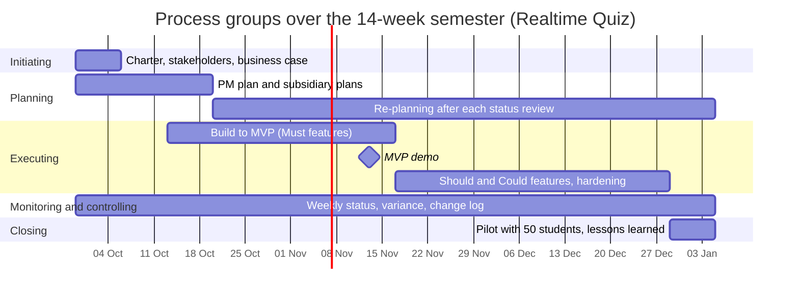

# Process groups mapping: Realtime Quiz platform

## Process groups over the 14-week semester

| Process group | Weeks active | Main activities | Outputs | Lab that produces them |
|---------------|--------------|-----------------|---------|------------------------|
| Initiating | 1 | Define project scope, identify sponsor and stakeholders, justify investment with business case, draft charter | Signed project charter, initial stakeholder register, approved business case | Lab 01 |
| Planning (Initial burst) | 1-3 | Scope decomposition, WBS creation, schedule network, cost estimation, risk and quality planning | Project management plan, WBS dictionary, schedule baseline, risk register | Labs 02, 03, 04 |
| Planning (Continuing re-planning) | 4-14 | Rolling-wave re-planning, sprint backlog refinement, risk reassessment, and scope adjustments | Updated sprint backlogs, risk log updates, change impact assessments | Labs 05, 06, 09, 10 |
| Executing | 3-13 | Frontend and backend development, WebSocket integration, quiz authoring engine, export module, testing | Working software releases, MVP build, unit/integration test suites, demo increments | Labs 03 to 10 |
| Monitoring and controlling | 1-14 | Weekly status reviews, schedule and cost variance tracking, risk reviews, and change control | Weekly progress reports, variance metrics, issue log, change request decisions | Labs 05, 06, 09 (tools), every lab (practice) |
| Closing | 14 | Execute 50-student live pilot, transfer platform to IT operations, archive documentation, capture lessons learned | Pilot trial report, deployment runbook, final project handover sign-off | Labs 12, 13, 14 |

## Process groups over the semester

## Phase gates

To enforce continued business justification throughout the project lifecycle, three formal phase gates are established where the Sponsor and Project Manager evaluate deliverables before authorizing subsequent phase progression:

1. **Gate 1: Charter and Initiation Approval (End of Week 1):**  
   - *Purpose:* Formally authorize project inception, commit resource hours (490 h), and allocate the cash budget cap (200 USD).  
   - *Evidence required:* Signed project charter, preliminary stakeholder register with role categorization, and the comparative business case demonstrating positive economic payback.

2. **Gate 2: MVP Midterm Review Gate (End of Week 7):**  
   - *Purpose:* Verify working functionality of all Must features (authoring, live timed sessions, instant scoring, WebSocket leaderboards, authentication) and determine whether to proceed with internal development or pivot to commercial SaaS (Option B).  
   - *Evidence required:* Live demonstration of core MVP features with zero critical severity defects, automated CI test suite passing with >= 80% line coverage, and updated budget variance showing expenditure within the 200 USD cap.

3. **Gate 3: Pilot and Operational Handover Readiness Gate (End of Week 13):**  
   - *Purpose:* Approve execution of the live 50-student classroom pilot and authorize handover to operational maintenance.  
   - *Evidence required:* Load test report demonstrating 100 simulated concurrent users with latency under 500 ms on 2 vCPU / 2 GB RAM, formal data protection sign-off from the Data Protection Officer (S08), and a validated deployment runbook with `docker-compose.prod.yml` approved by IT Operations (S06).
